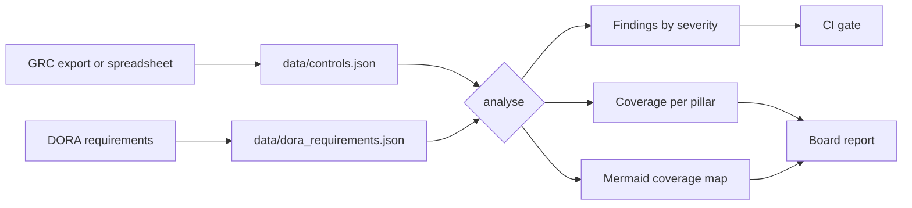
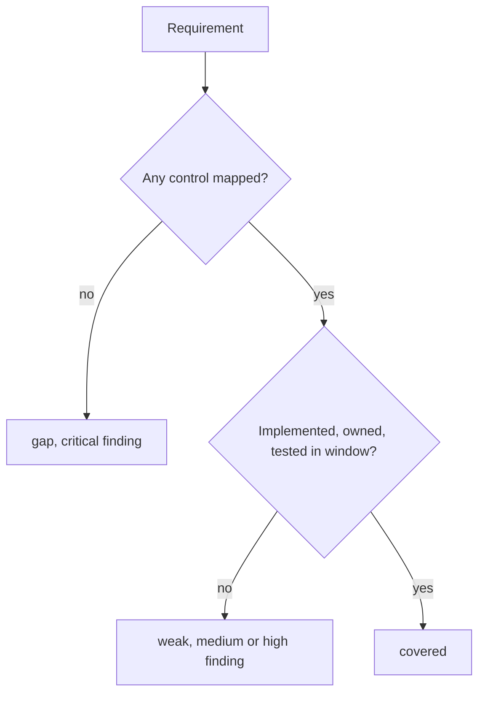
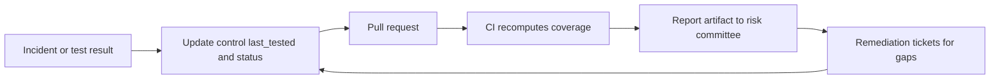

# dora-resilience-mapper

Turn DORA obligations into a living, testable control map. It answers the question a board or regulator will ask: **for each requirement, which control covers it, who owns it, and is the evidence fresh?**

Zero dependencies. Python 3.9+. Data is plain JSON, so you can export it from your GRC tool (ServiceNow, Archer, OneTrust, a spreadsheet) and run it in CI.

> The sample data in `data/` is illustrative. The article references are a working starting point; verify them and the RTS/ITS detail against the Official Journal texts before relying on them. This is not legal advice.

## Quick start

```bash
python -m unittest discover tests
python -m doramap gaps                      # findings by severity
python -m doramap report --out report.md    # coverage table + Mermaid map
python -m doramap diagram                   # Mermaid only
python -m doramap gaps --fail-on-gaps       # exit 1 on critical gaps (CI gate)
```

## How it works



## Coverage rule

A requirement is **covered** only if at least one mapped control is `implemented`, has a named owner, and was tested within `--max-age-days` (default 365). Mapped but unowned, unfinished or stale means **weak**. No mapped control means **gap**.



## Operating model



## Adapting it

1. Replace `data/controls.json` with your control inventory (`id`, `name`, `owner`, `status`, `last_tested`, `maps_to`).
2. Extend `data/dora_requirements.json` with sub-requirements from the RTS/ITS you are mapped against.
3. Make the CI gate blocking once the data reflects reality.

## Roadmap

- Third-party register import and concentration-risk scoring
- Per-control evidence links and sampling
- Crosswalk to NIST CSF 2.0 and ISO 27001 identifiers
