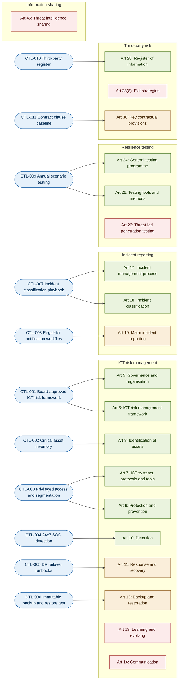

# DORA control coverage report
As of 2026-11-26. Overall effective coverage: **55%**

| Pillar | Covered | Weak | Gap | Coverage |
|---|---|---|---|---|
| ICT risk management | 6 | 2 | 2 | 60% |
| Incident reporting | 2 | 1 | 0 | 67% |
| Resilience testing | 2 | 0 | 1 | 67% |
| Third-party risk | 1 | 1 | 1 | 33% |
| Information sharing | 0 | 0 | 1 | 0% |

## Findings

| Severity | Item | Finding |
|---|---|---|
| critical | ICT-13 | no control mapped: Learning and evolving |
| critical | ICT-14 | no control mapped: Communication |
| critical | INF-45 | no control mapped: Threat intelligence sharing |
| critical | TPR-EXIT | no control mapped: Exit strategies |
| critical | TST-26 | no control mapped: Threat-led penetration testing |
| high | CTL-006 | no accountable owner |
| high | CTL-008 | no accountable owner |
| high | CTL-008 | never tested |
| medium | CTL-005 | evidence stale (555 days old) |
| medium | CTL-008 | status is in_progress |
| medium | CTL-011 | status is in_progress |

## Coverage map

